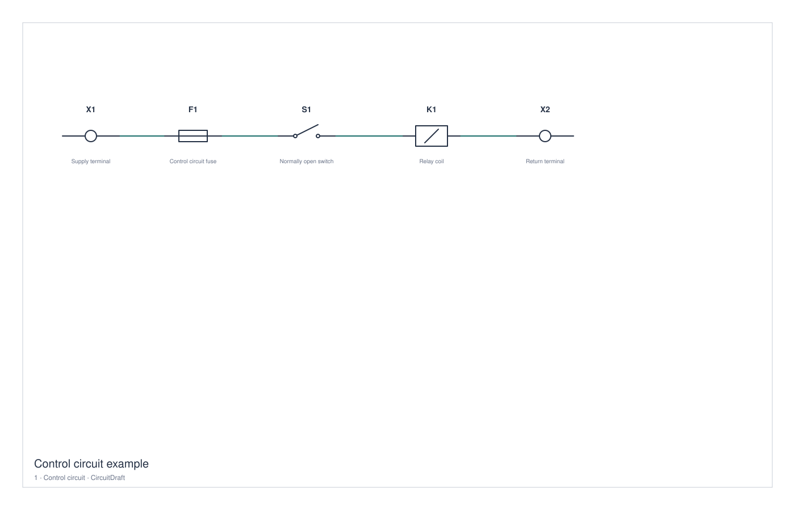

# CircuitDraft — 0.1 Alpha

**A bare-bones first version of a native Mac electrical schematic editor.**

> **v0.1.0-alpha is an experimental first release, not a finished ECAD application.** It has a tiny symbol library and basic editing tools. The goal is to let people try the idea and tell us whether a native Mac schematic editor with MCP automation would be useful. Expect missing features and rough edges.

[Download the 0.1 Alpha Mac build](https://github.com/WeJaWi/CircuitDraft/releases/tag/v0.1.0-alpha) · [Request a feature](https://github.com/WeJaWi/CircuitDraft/issues/new?template=feature_request.md) · [Report a bug](https://github.com/WeJaWi/CircuitDraft/issues/new?template=bug_report.md)

If this is something you would use, **star the repository or open an issue describing your workflow**. That feedback will help decide what to build next.



## What works in 0.1

- Seven original simplified symbols: resistor, normally open contact, coil, terminal, fuse, motor and protective ground.
- Placement, grid snapping, movement, 90-degree rotation, property editing, deletion and undo/redo.
- Basic orthogonal wires linked to symbol pins.
- Multiple schematic pages and a parts list across the project.
- Editable JSON projects, PDF/SVG page exports and CSV parts exports.
- Optional MCP tools that can read and edit the running Mac app.

## What is missing

**This is deliberately a very small alpha.** There is no EPLAN project import/export, simulator, electrical rules checker, automatic junction generation, obstacle-aware wire routing, cross-page electrical continuity, vendor catalog, PLC engineering, terminal/cable automation, macros or 3D/panel design. Crossing lines do not create electrical junctions. Each symbol placement counts once in the parts list; several functions are not reconciled into one physical device.

Symbols are simplified drawings and standards compliance has not been verified. Use this release to explore the prototype and give feedback; production design workflows remain outside its current scope.

## Run on Mac

Download `CircuitDraft-v0.1.0-alpha-macos-arm64.zip` from the [release page](https://github.com/WeJaWi/CircuitDraft/releases/tag/v0.1.0-alpha), unzip it into Downloads or Applications, and open `CircuitDraft.app`.

- **Apple silicon only**; the binary targets **macOS 14 or later**.
- Tested on an Apple silicon Mac running macOS 26. Older supported macOS versions have not been tested.
- Locally ad hoc signed, **not notarized**. macOS may require the normal manual approval for an app downloaded from the internet.
- The native app has no Python or third-party runtime dependency. Python is only needed for the optional MCP companions.

The app starts with an original demonstration project. `Example.circuitdraft.json` and `MCP-Demo.circuitdraft.json` are editable examples included with the source.

## Edit and save

Choose a symbol in the library and click the page to place it. Choose **Select** or press **V** with the canvas focused to move and edit symbols. The right inspector edits tags, descriptions, part numbers and manufacturers.

Press **W** for wires, then click a pin or grid point and the destination. Hold **Option** on the second click to switch the bend. Attached wires follow moved and rotated symbols; automatic routing around symbol bodies is not implemented.

**R** rotates, **Delete** removes the selection, **Escape** cancels the current tool, and arrow keys nudge a selected symbol. **Command-Z** and **Command-Shift-Z** undo and redo. The sidebar adds, renames and deletes pages.

**Command-S** saves a `.circuitdraft.json` project; **Command-O** opens one. The Export menu writes PDF/SVG for the current page or a CSV parts list across all pages.

## Build and test

With the Xcode command-line toolchain installed:

```sh
./build.sh
./test.sh
./test-automation.sh
```

The build creates `CircuitDraft.app` and `CircuitDraft-Mac.zip` for arm64. It uses a temporary directory for signing and packaging because iCloud Drive can attach metadata to a loose app in Documents that breaks strict signature verification. No package download is required for the native build. The initial release was built with Swift 6.3.3.

There are **23 model/export checks and 27 native automation checks**, plus real MCP protocol and interface verification. These verify the listed CircuitDraft behaviors, not EPLAN compatibility. See [test results](TEST-RESULTS.md).

## Optional MCP automation

The native companion exposes tools for projects, pages, symbols, pin connections, properties, parts lists and SVG. The app displays **MCP ready** when its local bridge is active. It uses local files and opens no network listener.

This repository also includes a pinned, MIT-licensed snapshot of [Canary-ECAD/eplan-mcp](https://github.com/Canary-ECAD/eplan-mcp). Its tool discovery works on Mac; **its live EPLAN actions still require a Windows machine with EPLAN installed**. The catalog's 220 upstream tools are not 220 implemented CircuitDraft features.

See [MCP installation, tools and limits](Integrations/README.md). The Python environment and your MCP client configuration are local setup steps; cloning this repository does not install or register them automatically.

## Project status and credits

CircuitDraft is an AI-assisted prototype written in SwiftUI and AppKit. Its initial scope was informed by an EPLAN package/API investigation; the application and simplified symbols are original implementations. It is an independent community experiment and is not affiliated with or endorsed by EPLAN.

Source is licensed under [MIT](LICENSE). The optional upstream integration retains its own [MIT notice](THIRD_PARTY_NOTICES.md). No proprietary EPLAN binaries, commercial symbol assets, installer files or recovered proprietary implementation code are included.

[Contribution guide](CONTRIBUTING.md) · [Changelog](CHANGELOG.md) · [Investigation notes](Research/INVESTIGATION.md)
